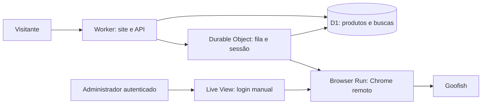

# JV Busca — busca hospedada no Cloudflare

Documento de implementação • 14/11/2026

## Resultado esperado e situação atual

O visitante abre a JV Busca, pesquisa em português e recebe anúncios salvos. Quando faltarem resultados, a API consulta o Goofish usando uma sessão do proprietário em um navegador remoto. Os novos anúncios são normalizados, traduzidos e salvos para as próximas buscas. O computador do proprietário pode ficar desligado após a implantação.

Este documento especifica a migração. **A implantação remota ainda não foi executada nem validada com o Goofish.** Hoje, a busca adicional usa `server.py`, `bridge.py` e a extensão instalada no Chrome local. Publicar somente a pasta `public/` disponibiliza o catálogo, mas não transfere a sessão nem publica a API Python.

O Cloudflare oferece Browser Run, anteriormente chamado Browser Rendering. Ele executa um Chrome remoto; isso não significa que o Goofish aceitará automaticamente a sessão ou o IP do servidor. A primeira etapa precisa validar esse acesso com a conta do proprietário.

## Arquitetura proposta



| Componente | Responsabilidade |
| --- | --- |
| Worker + Static Assets | Hospedar HTML, CSS, fontes, imagens locais e `/api/*` no mesmo domínio. |
| D1 | Guardar anúncios, categorias, traduções, buscas recentes, tarefas e horários de coleta. |
| Durable Object | Coordenar uma única sessão Goofish e uma consulta por vez; deduplicar solicitações iguais. |
| Browser Run | Abrir páginas Goofish, aguardar anúncios renderizados e extrair somente dados dos anúncios. |
| Live View administrativo | Permitir login ou renovação manual no navegador remoto. Nunca expor aos visitantes. |
| Armazenamento privado da sessão | Conservar estado mínimo de autenticação, cifrado, caso a restauração seja aceita pela origem. |

Não usar Cloudflare Tunnel para esta migração: ele encaminharia tráfego ao servidor local, que continuaria dependendo do computador ligado.

## Gratuito: o limite que define o projeto

O plano Free oferece **10 minutos de Browser Run por dia**, até três navegadores simultâneos e uma nova instância a cada 20 segundos. O catálogo salvo deve responder à maioria das buscas. Não manter um navegador gratuito ativo 24 horas; a sessão aberta também consome tempo quando está ociosa. [Limites oficiais](https://developers.cloudflare.com/browser-run/limits/)

O tempo máximo de inatividade configurável é de 20 minutos; sessões também podem terminar quando a plataforma é atualizada. A arquitetura precisa reconstruir o navegador e tratar autenticação expirada, em vez de pressupor uma sessão eterna. [Ciclo de vida e limites](https://developers.cloudflare.com/browser-run/limits/)

No plano pago, a tabela consultada inclui 10 horas de navegador por mês e cobra US$ 0,09 por hora adicional, além das condições do plano Workers e demais serviços. Não ativar um plano pago para cumprir a preferência atual de custo zero. [Preços oficiais](https://developers.cloudflare.com/browser-run/pricing/)

Configuração proposta para começar: uma consulta remota por vez, máximo de 30 segundos por tentativa e orçamento interno conservador de 480 segundos/dia, reservando parte da cota para login e testes. É um limite de projeto, não uma garantia de quantidade de buscas: inicialização, navegação e autenticação também consomem tempo. Ao atingir a cota, continuar atendendo o catálogo e informar indisponibilidade temporária da consulta adicional.

## Sessão remota: entrar e renovar

1. Criar uma sessão Browser Run na conta Cloudflare do proprietário.
2. Abrir a aba Goofish nessa sessão remota.
3. No painel Cloudflare, acessar Browser Run → Live Sessions → aba desejada → Open, usando o Live View.
4. O proprietário efetua o login manualmente. Não gravar senha, QR de login, códigos ou telas da conta em logs.
5. Confirmar que uma busca simples retorna anúncios e que uma ficha de produto abre. Se a origem exigir uma verificação, pausar a tarefa e solicitar intervenção do proprietário.
6. Registrar no serviço apenas o identificador da sessão e seu estado operacional. O identificador não deve ser entregue pelo endpoint público.
7. Para sobreviver ao encerramento do navegador, implementar exportação/restauração somente dos cookies e armazenamento necessários aos domínios Goofish autorizados, com cifra AES-GCM e chave em Worker Secret. Não guardar o perfil Chrome inteiro. Se essa restauração não for suficiente, marcar `reauth_required` e renovar pelo Live View.

A extensão atual **não exporta cookies**, portanto instalar o Worker não copia automaticamente o login do Chrome. O caminho preferido é entrar diretamente no navegador remoto. Login persistido e navegador em execução são coisas diferentes: preservar estado não garante que o site aceitará esse estado em outra sessão/IP.

O Live View permite ver e controlar uma aba remota. Seu link contém acesso sensível e deve permanecer restrito ao administrador; não colocar esse link no site público. [Documentação do Live View](https://developers.cloudflare.com/browser-run/features/live-view/)

## Fluxo da pesquisa

1. Validar a consulta: de 2 a 120 caracteres, categoria conhecida, página positiva e filtros numéricos limitados. Não aceitar URL arbitrária para o navegador visitar.
2. Normalizar espaços e caixa para a chave de cache; preservar a consulta original para exibição.
3. Consultar títulos originais e traduzidos no D1. Aplicar categoria, faixa de preço, favoritos no cliente, ordenação e paginação.
4. Retornar resultados locais imediatamente. Se a consulta remota for necessária, criar ou reutilizar uma tarefa por chave de consulta/filtros/idioma.
5. O Durable Object serializa a tarefa e verifica orçamento diário e autenticação. Uma chamada assíncrona precisa de execução durável com retomada; não depender apenas de uma Promise solta depois da resposta HTTP.
6. Abrir `https://www.goofish.com/search?q=...` usando `URLSearchParams`, no contexto autenticado. Esperar anúncios ou um estado explícito de login/verificação.
7. Extrair ID, URL canônica, título, preço, fotos disponíveis, localização e campos do vendedor fornecidos pela página. Não extrair mensagens, pedidos ou informações privadas da conta.
8. Deduplicar por ID. Upsert dos anúncios e associação às categorias, preservando traduções e galerias anteriores quando não houver novos dados.
9. Concluir a tarefa e retornar os resultados. Fechar páginas de trabalho e encerrar o navegador quando apropriado ao orçamento, preservando antes o estado autorizado.
10. Exibir `collectedAt` e tratar anúncios removidos. Não prometer estoque ou preço em tempo real para registros salvos.

Reutilizar uma sessão exige coordenação: um contexto novo e anônimo perde os cookies de login. Adaptar o exemplo oficial para o contexto autenticado do proprietário, protegido e serializado. [Reutilização de sessões](https://developers.cloudflare.com/browser-run/features/reuse-sessions/) e [Durable Objects com navegador](https://developers.cloudflare.com/browser-run/how-to/browser-run-with-do/)

## Contrato da API a implementar

| Rota | Comportamento |
| --- | --- |
| `GET /api/search?q=&category=&page=&sort=&minPrice=&maxPrice=` | Resultados persistidos, total e estado da busca adicional. |
| `POST /api/search/jobs` | Solicitar consulta remota; responder 202 com `jobId` opaco ou reaproveitar tarefa existente. |
| `GET /api/search/jobs/:id` | Estado e resultados daquela consulta; nunca incluir sessão, cookies ou diagnósticos privados. |
| `GET /api/products/:id` | Ficha salva e galeria disponível. |
| `POST /api/products/:id/refresh` | Atualização enfileirada e limitada, com o mesmo controle de orçamento. |
| `GET /api/categories` | Categorias e contagens do banco. |
| `GET /api/health` | Estado público resumido: catálogo disponível e consulta adicional disponível/indisponível. |
| `/admin/session/*` | Rotas privadas para iniciar, verificar, renovar ou encerrar a sessão; protegidas por Cloudflare Access. |

Exemplo de resposta de busca, sem credenciais:

```json
{
  "items": [],
  "page": 1,
  "perPage": 20,
  "total": 0,
  "source": "catalog",
  "live": {"state": "pending", "jobId": "identificador-opaco"}
}
```

Estados previstos: `pending`, `running`, `complete`, `reauth_required`, `verification_required`, `budget_exhausted`, `failed`. Para o visitante, usar mensagens simples, como “A busca adicional está indisponível agora. Você pode continuar pelos produtos disponíveis.” O administrador recebe o motivo específico em uma rota privada.

Não devolver o HTML bruto do Goofish. Servir JSON contendo apenas os campos definidos e renderizar textos com `textContent`, como no frontend atual.

## Persistência e tradução

Tabelas sugeridas:

- `products`: ID Goofish como chave, título original/PT, descrição original/PT, preço CNY numérico, dados públicos do vendedor, data de coleta, estado do anúncio.
- `product_images`: produto, URL da imagem, posição; unicidade por produto/URL canônica para evitar variações de tamanho duplicadas.
- `categories` e `product_categories`: associação muitos-para-muitos.
- `translations`: idioma de origem/destino, hash do texto, tradução e provedor.
- `search_cache`: chave normalizada, IDs em ordem, horário e validade sugerida de 15 minutos.
- `search_jobs`: estado, prazo, tentativas limitadas e erro sanitizado.
- `usage_daily`: orçamento diário consumido/reservado, atualizado de forma serializada.

Importar `public/data/products.json` com IDs estáveis. Não duplicar um mesmo produto por pertencer a mais de uma categoria. Guardar preço em yuan e aplicar a cotação salva ao responder; informar data e caráter estimado da conversão para reais.

As traduções atuais do Argos já estão incluídas no catálogo. **O modelo local Argos não migra automaticamente para um Worker.** Para anúncios novos, implementar um serviço de tradução compatível com a hospedagem, avaliar sua cota/custo e guardar cada tradução. Enquanto essa etapa não estiver disponível, manter o original identificado como tal, sem inventar uma tradução. A prova de conceito só estará completa em português quando esse serviço também funcionar com o PC desligado.

## Passos de implementação

### 1. Prova de acesso antes da migração completa

Na conta Cloudflare, testar Browser Run + Live View + Goofish: login, uma pesquisa e um detalhe. Repetir após fechar/recriar o navegador com estado restaurado. Se o site não aceitar o ambiente, registrar o bloqueio e manter o catálogo salvo como modo público. Não prometer que Cloudflare contorna verificações.

### 2. Criar o projeto remoto

Em uma pasta separada do servidor local:

```powershell
npm create cloudflare@latest -- jv-busca-cloud
cd jv-busca-cloud
npm install @cloudflare/puppeteer
npx wrangler login
npx wrangler d1 create jv-busca
```

Escolher Worker com TypeScript. Configurar `nodejs_compat`, binding do navegador, D1, Static Assets e Durable Object. Estes comandos criam a estrutura; os handlers e migrações descritos neste documento ainda precisam ser implementados.

Exemplo de configuração, com identificador a substituir:

```jsonc
{
  "name": "jv-busca",
  "main": "src/index.ts",
  "compatibility_date": "2026-11-14",
  "compatibility_flags": ["nodejs_compat"],
  "assets": {
    "directory": "./public",
    "binding": "ASSETS",
    "run_worker_first": ["/api/*", "/admin/*"]
  },
  "browser": {"binding": "BROWSER"},
  "d1_databases": [{
    "binding": "DB", "database_name": "jv-busca",
    "database_id": "SUBSTITUIR_PELO_ID_CRIADO"
  }],
  "durable_objects": {"bindings": [{
    "name": "GOOFISH_SESSION", "class_name": "GoofishSession"
  }]},
  "migrations": [{"tag": "v1", "new_sqlite_classes": ["GoofishSession"]}]
}
```

Referências: [configuração dos arquivos estáticos](https://developers.cloudflare.com/workers/static-assets/binding/), [criação do D1](https://developers.cloudflare.com/d1/get-started/) e [navegador com Durable Objects](https://developers.cloudflare.com/browser-run/how-to/browser-run-with-do/).

### 3. Adaptar o código existente

| Arquivo atual | Mudança necessária |
| --- | --- |
| `public/shop.js` | Buscar pela API no mesmo domínio; tratar tarefas remotas e estados. Remover a dependência `source=chrome` na versão hospedada. |
| `public/data/products.json` | Manter como carga inicial e fallback; gerar importação para D1. |
| `catalog.py` | Portar normalização, deduplicação, associação e retomada para serviços TypeScript/D1. |
| `extension/background.js` | Aproveitar lógica de leitura de anúncios e galeria dentro do navegador remoto; adaptar APIs Chrome da extensão para Puppeteer. |
| `bridge.py` | Substituir por coordenação do Durable Object; não publicar a chave local. |
| `translate_catalog.py` | Aproveitar traduções prontas; implementar provedor remoto para textos novos. |

Não subir `.bridge-key`, `extension/config.js`, perfil de navegador, `.venv`, cookies ou arquivos de sessão para Static Assets. Publicar somente os arquivos públicos planejados e código servidor sem segredos incorporados.

### 4. Proteção e operação

Proteger `/admin/*` por Cloudflare Access e validar a identidade no servidor. Usar Worker Secrets para a chave de cifra; nunca salvar segredo em `wrangler.jsonc`. Limitar frequência por visitante e globalmente, bloquear URLs externas arbitrárias, usar SQL parametrizado e unir solicitações iguais. CORS sozinho não protege uma API pública.

As consultas aceitam apenas termos de busca e IDs numéricos de produto. Manter allowlist dos destinos Goofish na navegação; não criar um proxy aberto. Não registrar cookies, URLs de Live View ou respostas de páginas privadas. Criar botão administrativo para revogar estado salvo e encerrar sessões.

Em erro de login ou verificação, parar a automação dessa sessão. Em erro transitório, no máximo uma nova tentativa com espera e respeito ao `Retry-After`. Em cota esgotada, servir o catálogo sem novas chamadas ao navegador até a renovação do orçamento.

### 5. Testes de aceitação antes de publicar

- Importação com mesma quantidade de IDs únicos do catálogo local, categorias e galerias preservadas.
- Busca local, filtros, preços, paginação e favoritos funcionando com a API remota.
- Consulta inédita retorna anúncios reais e a repetição usa cache sem abrir outro navegador.
- Dez buscas simultâneas idênticas geram uma tarefa remota, sem trocar o estado da página entre visitantes.
- Sessão expirada, verificação e limite diário exibem estados corretos sem inventar resultados.
- Galeria deduplica versões redimensionadas; campos ausentes do vendedor continuam ausentes.
- Rotas administrativas negam acesso anônimo; respostas públicas não incluem credenciais ou identificadores de sessão.
- Desligar o servidor local, pausar a extensão e fechar o Chrome. Repetir uma busca inédita e confirmar persistência no D1.
- Reiniciar a sessão remota, validar restauração e testar renovação manual caso seja recusada.
- Verificar tradução de um anúncio novo sem executar Argos no computador local.

### 6. Publicação e reversão

Depois de implementar e testar os componentes, executar migrações D1, importar o catálogo, configurar o acesso administrativo e publicar com `npx wrangler deploy`. Associar o domínio e testar novamente em celular. O catálogo estático deve permanecer como fallback se a coleta remota for desativada.

Só marcar a migração como concluída depois do teste com o computador desligado. O serviço pode continuar precisando de login manual ocasional; isso não exige manter o PC ligado, mas exige que o proprietário consiga acessar o painel quando a autenticação vencer.
